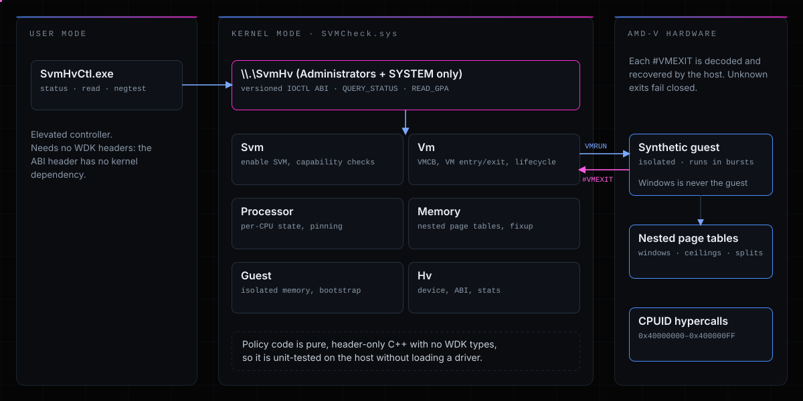

# SVMCheck: showcase

SVMCheck is a Windows kernel-mode driver that explores **AMD-V (SVM)** hardware virtualization from the ground up. It builds a small, isolated *synthetic guest*, runs it on real hardware with `VMRUN`, handles the resulting `#VMEXIT`s, and exposes a tightly scoped, administrator-only interface for inspecting guest memory from user mode.

It is a research and learning project: a way to understand how a hypervisor works by building one step by step and verifying each piece on live hardware. Windows is **never** the guest.

> **Status: in progress.** SVMCheck is under active development, so this showcase describes where the project stands today and will keep changing as new phases are built and verified.

> **About this repository.** This is a documentation-only showcase. The source code is private. I'm happy to walk through it in an interview or share read-only access on request.

## At a glance

| | |
| :-- | :-- |
| **Status** | In progress |
| **Role** | Main architect |
| **Started** | October 2026, built in verified phases |
| **Stack** | C++ and x64 assembly, Windows kernel (WDM), AMD SVM with nested paging |
| **Size** | ~17.9k lines across 69 source files |
| **Tests** | 9 host-side test suites (2,661 nested-paging policy checks, 75 ABI checks, 16 page-walk checks) plus on-hardware tests |

## What it does

- **SVM bring-up.** Detects SVM and nested-paging support per logical processor, enables SVM, and allocates the per-CPU host-save area, VMCB and host-state scratch pages.
- **Guest lifecycle.** A state machine (`Uninitialized -> Prepared -> Entering -> ... -> Stopped`) guards every transition, so a failed entry cannot leave a half-initialised guest behind.
- **Real VMRUN on every CPU.** The first hardware VM entry was proven on one processor, then extended to every logical processor, with repeated-entry regression tests.
- **Host state preservation.** An assembly layer saves and restores host registers (including XMM state) across guest runs, with round-trip and integrity self-tests.
- **VM-exit handling.** A dispatcher decodes exits and recovers the host: CPUID interception and resume, MSR interception with write emulation and injected `#GP`, exception and shutdown intercepts, and next-RIP (`NRIPS`) gating.
- **Nested paging.** Identity-mapped NPT windows with a permission *ceiling*. Faults are fixed up only inside registered windows, entries are only ever widened, and 2 MB leaves are split when a fault lands inside them.
- **Hypercall interface.** A reserved CPUID leaf range (`0x40000000-0x400000FF`) answered in software, with a signature, version info, and `Ping` / `GetVersion` commands gated to CPL 0.
- **User-mode controller.** `SvmHvCtl.exe` talks to the driver over a versioned IOCTL ABI. See [docs/abi.md](docs/abi.md).

## Execution model: burst

The driver builds the guest, runs it to completion on a pinned Windows thread (`VMRUN -> #VMEXIT -> resume -> stop`), and returns to Windows. Guest runs happen before the control device is created, so no guest is executing while an IOCTL is serviced and the nested page table is quiescent for reads.

This was a deliberate decision. A "permanent" model, where Windows itself is virtualized, would force every handler to be non-blocking and lock-free at elevated IRQL. The ABI documents this boundary and requires a major-version bump if the model ever changes.

## Design decisions

The interesting parts are the decisions behind the code: fail-closed defaults, why a 2 MB leaf is split instead of widened, and what testing on real hardware taught me. They're written up in [docs/design-decisions.md](docs/design-decisions.md).

## How it was built

Each phase was verified on real hardware before the next began, and each commit message records what was checked.

| Phase | Work |
| :-- | :-- |
| 1. Baseline | Guest state capture, per-processor state verification, restoration guards |
| 2. VM entry | Per-CPU readiness validation, entry scaffold, lifecycle state machine, first real `VMRUN`, multi-CPU entry, hardened intercepts |
| 3. VM exits | NRIPS gating, CPU pinning, MSR interception and emulation, NPF handling, permission enforcement, 2 MB leaves and splitting |
| 4. Interface | Versioned hypercall ABI, CPUID hypercall proof of concept, admin-only IOCTL device, guest-physical reads, negative-test battery |

## Testing

- **Host-side unit tests** cover the pure policy code: ABI validation, CPU affinity, memory policy, MSR intercepts and permission map, next-RIP, NPF decode, and the nested-page-table fixup and walk policies. The policy code has no kernel dependency, so it runs without loading a driver.
- **On-hardware tests** run during driver load: repeated-VMRUN regression, CPUID and MSR intercept-and-resume, nested page fault handling, NPT fixup, large-page split, faults inside a 2 MB leaf, and the hypercall path.
- **Negative IOCTL battery** (`SvmHvCtl negtest`) drives six bad-input cases through the real `DeviceIoControl` surface against the live driver. All six pass, and each returns a defined status instead of crashing.

## Scope and non-goals

SVMCheck is a learning vehicle. It does not virtualize Windows, has no guest-memory write interface, and makes no security guarantees beyond those described here. It requires an AMD CPU with SVM and nested paging, and should only be run on hardware you are willing to crash.

---

Documentation and diagrams © Noah. All rights reserved. The source code is not published.
